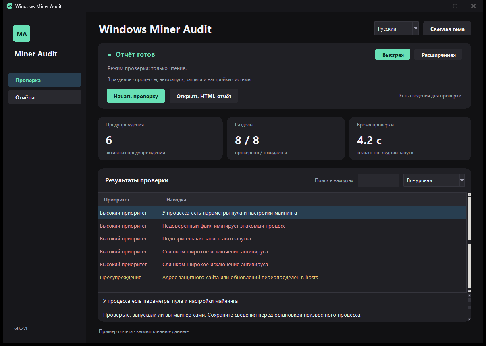
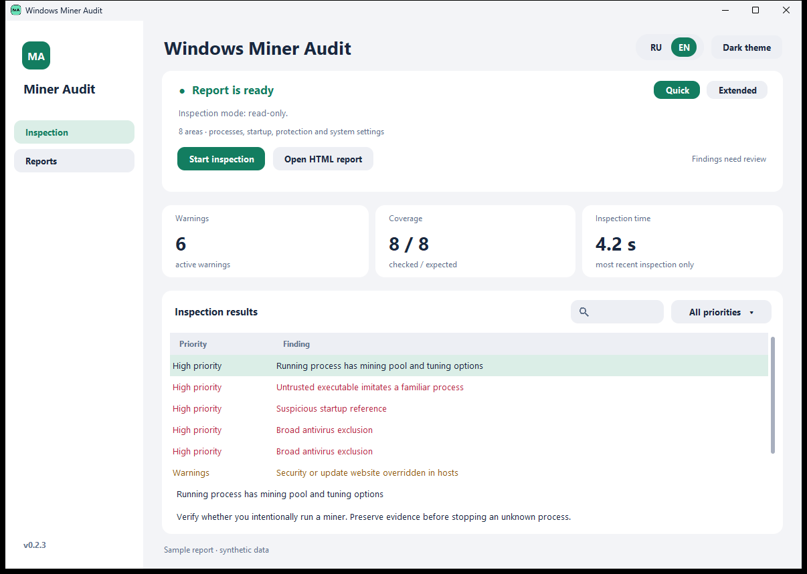

# Windows Miner Audit

[Русский](#русский) · [English](#english) · [Releases](https://github.com/qLage/windows-miner-audit/releases)

## Русский

[English](README.en.md) · [Главная](README.md) · Windows 10/11 x64 · [Проект в портфолио](https://qlage.github.io/case-miner-audit.html)

### Скачать и запустить

**[Скачать WindowsMinerAudit.exe](https://github.com/qLage/windows-miner-audit/releases/latest/download/WindowsMinerAudit.exe)**

[Страница релиза](https://github.com/qLage/windows-miner-audit/releases/latest) · [SHA256SUMS.txt](https://github.com/qLage/windows-miner-audit/releases/latest/download/SHA256SUMS.txt)

Это portable-программа: запустите один `.exe`. Python, установка, права администратора, ярлыки и регистрация в Windows для обычного запуска не нужны. Рядом создаётся папка `WindowsMinerAudit-data` с настройками и отчётами. Храните программу в доступной для записи папке; для переноса настроек перемещайте её вместе с этой папкой. Временная распаковка встроенного Python/Tk выполняется в TEMP и очищается при штатном выходе.



### Первая проверка

1. В разделе «Проверка» выберите «Быстрая» и нажмите «Начать проверку».
2. Выберите строку в списке находок, чтобы увидеть признаки и рекомендацию. Если часть данных недоступна, причина указана в «Ограничениях проверки».
3. Нажмите «Открыть HTML-отчёт» для чтения в браузере. Предыдущие завершённые проверки доступны в разделе «Отчёты».

«Расширенная» добавляет проверку служб, WMI и сетевой активности.

### Интерфейс

В интерфейсе два раздела: «Проверка» и «Отчёты». При запуске восстанавливается последний отчёт. Кнопка HTML открывает его в веб-браузере, выбранном для HTTPS, даже если файлы `.html` назначены на редактор. В истории есть отдельные кнопки просмотра и открытия в браузере.

- Русский и английский языки, тёмная и светлая темы. Выбор сохраняется локально.
- Быстрая проверка: 8 разделов. Расширенная: 14 разделов.
- Кнопка остановки, фактический ход сбора, поиск и фильтр находок.
- Выбор строки показывает сведения, причину и рекомендацию.
- История локальных отчётов; HTML и JSON сохраняются рядом с программой.

В покое сканирование не выполняется. Сбор идёт в отдельном процессе только после нажатия кнопки; при остановке завершается только созданный программой сборщик. Нет фоновой службы, автозапуска, веб-движка и автоматических загрузок файлов.

### Проверяемые признаки

| Быстрая проверка | Расширенная проверка дополнительно |
|---|---|
| Процессы, аргументы пулов и настройки CPU/GPU-майнинга | Службы и постоянные обработчики WMI |
| Подмена системных имён, ограниченная проверка подписей | Перехваты IFEO, Winlogon, AppInit |
| Планировщик, Run и RunOnce | Файлы и ярлыки папок автозапуска |
| Исключения Defender, в том числе политики | Связи процесса с некоторыми портами пулов |
| Защита Defender, hosts, запреты записи в папки антивирусов | Секундный замер CPU с сопоставлением пути и подписи |
| Настройки RDP и свободное место | До 40 уникальных подписей процессов из доступных для записи папок |

Обычный PowerShell `-EncodedCommand` ограниченно декодируется как текст UTF-16LE; содержимое не запускается. Ни порт, ни высокая нагрузка, ни неподписанный файл сами по себе не объявляются вирусом. Легально запущенный майнер тоже может соответствовать правилам майнинга.

**Программа не гарантирует обнаружение любого майнера и не заменяет антивирус.** Она не является сканером памяти ядра, GPU-памяти, прошивки или всего диска и не содержит полной антивирусной базы. Защищённые процессы могут оставаться недоступными даже администратору. Неполные разделы отмечаются явно; отсутствие совпадений не означает гарантированно чистую систему. Для скрывающихся в работающей Windows угроз изучите [Microsoft Defender Offline](https://learn.microsoft.com/en-us/defender-endpoint/microsoft-defender-offline). Программа не запускает перезагрузку или исправления автоматически.

[Методы, ограничения и первичные источники](docs/DETECTION.md) · [Что проверено](VERIFICATION.md)

### Запуск исходников и CLI

Исходники требуют Python 3.10+ с Tkinter. Дополнительных библиотек для работы нет.

```powershell
git clone https://github.com/qLage/windows-miner-audit.git
cd windows-miner-audit
python gui.py
python audit.py --lang ru
python audit.py --deep --lang ru
python audit.py --snapshot examples/suspicious.json --lang ru --output reports/demo
python -m unittest discover -s tests -v
python gui.py --self-test --artifacts gui-artifacts
```

`Start-GUI.cmd` открывает графический интерфейс; `Start-Audit.cmd` сохраняет консольный вариант. Коды CLI: `0` — нет активных совпадений правил, `1` — находки, `2` — неполная проверка или ошибка. Пример JSON вымышленный; для него код `1` ожидаем.

### Сборка portable EXE

```powershell
python -m venv .build-env
.\.build-env\Scripts\python.exe -m pip install -r build-requirements.txt
.\.build-env\Scripts\python.exe build_windows.py --output dist --work build
.\.build-env\Scripts\python.exe verify_windows_package.py --directory dist
```

Получится `dist/WindowsMinerAudit.exe` и `SHA256SUMS.txt`. Исходники, GUI и EXE проверяются отдельно; сценарий сборки не создаёт установщик.

Отчёты могут содержать личные пути и названия задач. Типичные секреты скрываются, но полная анонимизация не гарантируется. Перед публикацией просмотрите отчёт. MIT · [SECURITY.md](SECURITY.md).

## English

[Русский](README.ru.md) · [Home](README.md) · Windows 10/11 x64 · [Portfolio case study](https://qlage.github.io/case-miner-audit.html)

### Download and run

**[Download WindowsMinerAudit.exe](https://github.com/qLage/windows-miner-audit/releases/latest/download/WindowsMinerAudit.exe)**

[Release page](https://github.com/qLage/windows-miner-audit/releases/latest) · [SHA256SUMS.txt](https://github.com/qLage/windows-miner-audit/releases/latest/download/SHA256SUMS.txt)

A portable application: run one `.exe`. No Python installation, administrator privileges, shortcuts or Windows registration are needed for ordinary use. Settings and reports live in `WindowsMinerAudit-data` beside the executable. Use a writable folder and move this data folder with the executable to retain settings. The bundled Python/Tk runtime temporarily extracts into TEMP and is removed on normal exit.



### First inspection

1. Open **Inspection**, select **Quick**, then select **Start inspection**.
2. Select a finding to review the evidence and recommendation. **Inspection limitations** explains any collection gaps.
3. Select **Open HTML report** to read the result in a browser. Previous completed inspections are available in **Reports**.

**Extended** adds checks for services, WMI and network activity.

### Interface

The interface has two sections: Inspection and Reports. The most recent saved report is restored on startup. HTML reports open in the registered HTTPS web browser even when `.html` files are associated with an editor. Report history has explicit view and browser-open actions.

- Russian and English, dark and light themes; preferences saved locally.
- Quick inspection covers 8 areas; extended inspection covers 14.
- Stop control, actual collection progress, search and finding filters.
- Select a finding to see evidence, reasoning and recommended next steps.
- Local report history; HTML and JSON are stored beside the executable.

No inspection runs at rest. Collection starts in an owned subprocess only after you request it; stopping it terminates only that collector. There is no background service, autostart, web engine or automatic file upload.

### Detection scope

| Quick inspection | Extended inspection adds |
|---|---|
| Processes, pool endpoints and CPU/GPU mining options | Services and permanent WMI consumers |
| System-name impersonation and bounded signature checks | IFEO, Winlogon and AppInit hooks |
| Scheduled tasks, Run and RunOnce | Startup-folder scripts and shortcuts |
| Effective and policy-based Defender exclusions | Correlations with selected pool-related ports |
| Defender protection, hosts and security-directory deny ACLs | A one-second CPU sample correlated with path/signature |
| RDP configuration and free storage | At most 40 distinct writable-location executable signatures |

Conventional PowerShell `-EncodedCommand` payloads are bounded and decoded as UTF-16LE text only, never executed. A port, high CPU use or an unsigned file alone is not a malware verdict. Authorized mining can also match mining rules.

**This application cannot guarantee detection of every miner and does not replace antivirus software.** It is not a kernel-memory, GPU-memory, firmware or full-disk scanner and has no complete antivirus signature database. Protected processes may remain inaccessible even with administrator rights. Partial coverage is explicit; no matches do not prove a clean system. For threats hiding from running Windows, review [Microsoft Defender Offline](https://learn.microsoft.com/en-us/defender-endpoint/microsoft-defender-offline). This app never automatically reboots or remediates the PC.

[Methods, limits and primary sources](docs/DETECTION.md) · [Verification](VERIFICATION.md)

### Source and CLI

Source execution requires Python 3.10+ with Tkinter; there are no additional runtime packages.

```powershell
git clone https://github.com/qLage/windows-miner-audit.git
cd windows-miner-audit
python gui.py
python audit.py --lang en
python audit.py --deep --lang en
python audit.py --snapshot examples/suspicious.json --lang en --output reports/demo
python -m unittest discover -s tests -v
python gui.py --self-test --artifacts gui-artifacts
```

`Start-GUI.cmd` opens the desktop interface; `Start-Audit.cmd` retains console usage. CLI exit codes: `0` no active rule matches, `1` findings, `2` incomplete inspection or failure. The synthetic fixture intentionally exits with code `1`.

### Build the portable EXE

```powershell
python -m venv .build-env
.\.build-env\Scripts\python.exe -m pip install -r build-requirements.txt
.\.build-env\Scripts\python.exe build_windows.py --output dist --work build
.\.build-env\Scripts\python.exe verify_windows_package.py --directory dist
```

Outputs are `dist/WindowsMinerAudit.exe` and `SHA256SUMS.txt`. Source, GUI and packaged EXE are checked separately. The build does not create an installer.

Reports can contain private paths and task names. Common secrets are redacted, but this is not complete anonymization. Review before sharing. MIT · [SECURITY.md](SECURITY.md).
