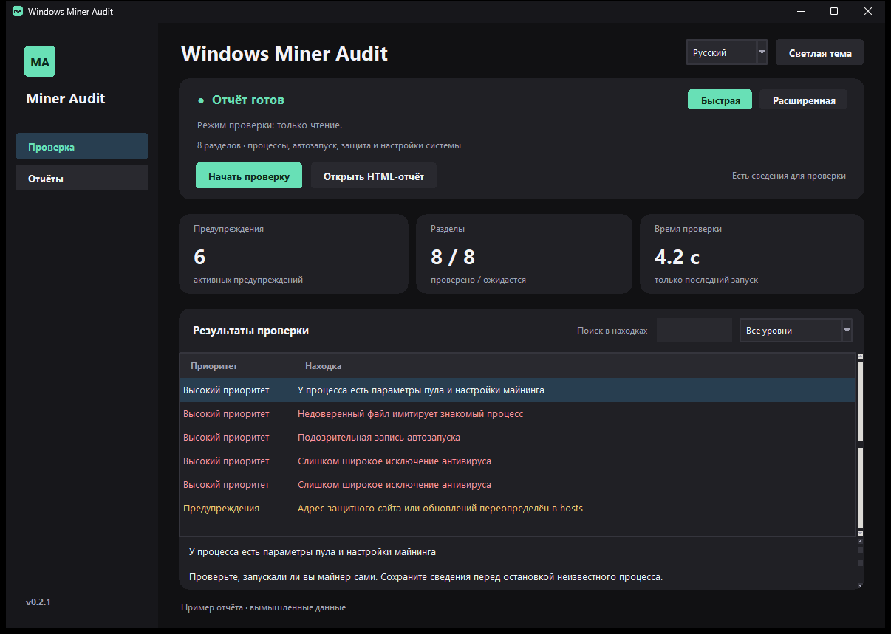

# Windows Miner Audit

[English](README.en.md) · [Главная](README.md) · Windows 10/11 x64

## Скачать и запустить

**[Скачать WindowsMinerAudit.exe](https://github.com/qLage/windows-miner-audit/releases/latest/download/WindowsMinerAudit.exe)**

Это portable-программа: запустите один `.exe`. Python, установка, права администратора, ярлыки и регистрация в Windows для обычного запуска не нужны. Рядом создаётся папка `WindowsMinerAudit-data` с настройками и отчётами. Храните программу в доступной для записи папке; для переноса настроек перемещайте её вместе с этой папкой. Временная распаковка встроенного Python/Tk выполняется в TEMP и очищается при штатном выходе.



## Интерфейс

В интерфейсе два раздела: «Проверка» и «Отчёты». При запуске восстанавливается последний отчёт. Кнопка HTML открывает его в веб-браузере, выбранном для HTTPS, даже если файлы `.html` назначены на редактор. В истории есть отдельные кнопки просмотра и открытия в браузере.


- Русский и английский языки, тёмная и светлая темы. Выбор сохраняется локально.
- Быстрая проверка: 8 разделов. Расширенная: 14 разделов.
- Кнопка остановки, фактический ход сбора, поиск и фильтр находок.
- Выбор строки показывает сведения, причину и рекомендацию.
- История локальных отчётов; HTML и JSON сохраняются рядом с программой.

В покое сканирование не выполняется. Сбор идёт в отдельном процессе только после нажатия кнопки; при остановке завершается только созданный программой сборщик. Нет фоновой службы, автозапуска, веб-движка и автоматических загрузок файлов.

## Проверяемые признаки

| Быстрая проверка | Расширенная проверка дополнительно |
|---|---|
| Процессы, аргументы пулов и настройки CPU/GPU-майнинга | Службы и постоянные обработчики WMI |
| Подмена системных имён, ограниченная проверка подписей | Перехваты IFEO, Winlogon, AppInit |
| Планировщик, Run и RunOnce | Файлы и ярлыки папок автозапуска |
| Исключения Defender, в том числе политики | Связи процесса с некоторыми портами пулов |
| Защита Defender, hosts, запреты записи в папки антивирусов | Секундный замер CPU с сопоставлением пути и подписи |
| Настройки RDP и свободное место | До 40 уникальных подписей процессов из доступных для записи папок |

Обычный PowerShell `-EncodedCommand` ограниченно декодируется как текст UTF-16LE; содержимое не запускается. Ни порт, ни высокая нагрузка, ни неподписанный файл сами по себе не объявляются вирусом. Легально запущенный майнер тоже может соответствовать правилам майнинга.

**Программа не гарантирует обнаружение любого майнера и не заменяет антивирус.** Она не является сканером памяти ядра, GPU-памяти, прошивки или всего диска и не содержит полной антивирусной базы. Защищённые процессы могут оставаться недоступными даже администратору. Неполные разделы отмечаются явно; отсутствие совпадений не означает гарантированно чистую систему. Для скрывающихся в работающей Windows угроз изучите [Microsoft Defender Offline](https://learn.microsoft.com/en-us/defender-endpoint/microsoft-defender-offline). Программа не запускает перезагрузку или исправления автоматически.

[Методы, ограничения и первичные источники](docs/DETECTION.md) · [Что проверено](VERIFICATION.md)

## Запуск исходников и CLI

Исходники требуют Python 3.10+ с Tkinter. Дополнительных библиотек для работы нет.

```powershell
python gui.py
python audit.py --lang ru
python audit.py --deep --lang ru
python audit.py --snapshot examples/suspicious.json --lang ru --output reports/demo
python -m unittest discover -s tests -v
python gui.py --self-test --artifacts gui-artifacts
```

`Start-GUI.cmd` открывает графический интерфейс; `Start-Audit.cmd` сохраняет консольный вариант. Коды CLI: `0` — нет активных совпадений правил, `1` — находки, `2` — неполная проверка или ошибка. Пример JSON вымышленный; для него код `1` ожидаем.

## Сборка portable EXE

```powershell
python -m venv .build-env
.\.build-env\Scripts\python.exe -m pip install -r build-requirements.txt
.\.build-env\Scripts\python.exe build_windows.py --output dist --work build
```

Получится `dist/WindowsMinerAudit.exe` и `SHA256SUMS.txt`. Исходники, GUI и EXE проверяются отдельно; сценарий сборки не создаёт установщик.

Отчёты могут содержать личные пути и названия задач. Типичные секреты скрываются, но полная анонимизация не гарантируется. Перед публикацией просмотрите отчёт. MIT · [SECURITY.md](SECURITY.md).
